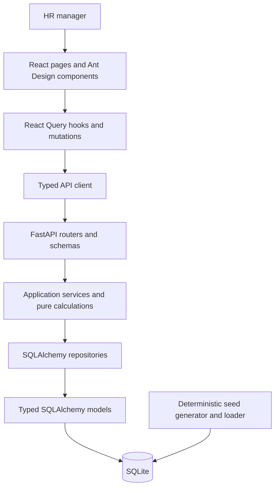

# StaffSense: Current Architecture

**Author:** @Deep Kokje  
**Last updated:** 25 Oct 2026

This document describes the implemented system. See
[REQUIREMENTS.md](./REQUIREMENTS.md) for current scope and
[plan.md](./plan.md) for the delivered feature summary.

## Stack

- Backend: Python 3.12, FastAPI, SQLAlchemy 2.x and SQLite.
- Frontend: Vite, React, strict TypeScript, Ant Design, React Query and
  react-router-dom. Recharts renders the dashboard cost pie.
- Validation: pytest, Ruff, Vitest, Testing Library and the TypeScript compiler.

## Boundaries

Routers parse HTTP inputs and serialize outputs. Services enforce business rules
and coordinate repository operations; pure calculation functions have no database
or FastAPI dependencies. Repositories own application SQL and persistence.
The seed loader separately populates the same model tables.

Frontend components do not fetch data directly. Typed API functions are called
by React Query hooks and mutations. Shared query keys support invalidation after
employee writes. The dashboard reuses the existing insight hooks rather than
adding an endpoint or duplicating requests.

## Data model

| Entity | Stored data |
| --- | --- |
| Employee | Identity, unique email, role, level, department, country, local currency and salary, denormalized USD salary, gender, manager, employment type, hire date, last raise date and status. |
| SalaryBand | Title, level, country, currency and ordered minimum/midpoint/maximum salaries. Unique per title, level and country. |
| SalaryHistory | Employee reference, old/new local salaries, currency and timestamp. |
| FxRate | Currency key and positive integer usd_rate_e6. |

Models use SQLAlchemy typed mappings, foreign keys, check constraints and indexes
for common employee filters and peer-group queries.

## Money and statistics

- Store money and FX rates as integers, never floating-point or SQLite
  Numeric/Decimal columns.
- The pure money module owns supported currency exponents and Decimal-based FX
  conversion with half-even rounding.
- Statistical interpolation, ratios, raise costs and percentage changes use
  integer arithmetic and the shared half-even division helper.
- A peer group is title + level + country. Benchmark and outlier statistics
  require at least five eligible employees.
- Missing FX rates and incompatible currencies produce errors rather than
  fabricated monetary values.

## Employee writes and salary history

1. Validate the input schema, employee, unique email, manager chain and FX rate.
2. Reject updates that change currency.
3. Recompute USD salary using the money module.
4. On an actual salary change, build a signed change using an injected UTC clock
   and insert a history row. A raise updates last_raise_date; a cut preserves it.
5. Commit the employee and history together through the repository transaction,
   or roll both back on failure.
6. Return the employee and invalidate affected frontend query caches.

Creating an employee starts without history. Deleting checks direct reports,
then removes history and the employee in one transaction. History retrieval
checks employee existence and orders rows by changed_at descending, then ID
descending. Seeded and newly recorded rows use the same change calculations.
SQLite retains the existing offset-free datetime representation; stored history
timestamps are treated as UTC.

## Implemented HTTP surfaces

| Surface | Endpoints |
| --- | --- |
| Health | GET /health |
| Directory | GET /employees, GET /employees/{id} |
| Employee writes | POST /employees, PUT /employees/{id}, DELETE /employees/{id} |
| History | GET /employees/{id}/salary-history |
| Benchmarks | GET /insights/benchmarks |
| Attention | GET /insights/bands, GET /insights/outliers |
| What-if | GET /insights/what-if/bring-to-band-min, GET /insights/what-if/raise |

## Insight behavior

| Insight | Calculation |
| --- | --- |
| Benchmarks | Local-currency min, p25, median, p75 and max per peer group, with explicit insufficient-data results. |
| Band compliance | Inclusive local salary boundaries; integer per-mille compa-ratio and band-gap amounts. Missing bands have a separate summary count. |
| Outliers | Signed deviation from peer median in integer per-mille; rounded absolute deviations strictly above 200 are flagged. |
| Band-minimum cost | Sum positive local shortfalls per country, then convert each country total to USD once. Employees without bands are skipped. |
| Department raise cost | Round each local raise from integer basis points, sum per country, then convert once per country. New USD payroll equals current payroll plus total cost. |

All insights use ACTIVE and ON_LEAVE employees. Directory queries use server-side
filtering, sorting and pagination; insight repositories retrieve the inputs needed
for pure calculations.

## Frontend surfaces

- `/`: four-card dashboard with band/outlier bar graphs, country-cost pie and
  detail links.
- `/employees`: filters and employee table, create/edit form drawer, confirmed
  deletion and salary-history drawer.
- `/insights/benchmarks`: peer-group filters and benchmark table.
- `/insights/attention`: band compliance and outlier tabs, URL-selected tab,
  filters and server pagination.
- `/insights/what-if`: automatic band-minimum estimate and submitted department
  raise calculator.

Each surface handles relevant loading, error, retry and empty states.
Salary and percentage input parsing uses string operations to produce integers.
Display helpers format API values without recomputing business calculations.

## Validation

Backend tests cover pure calculations, database integrity, validation, API shapes
and transaction rollback. Frontend tests use mocked APIs without network access
and cover forms, navigation, formatting and cache refresh. The production build
includes strict TypeScript checking. An isolated benchmark script times current
insight endpoints against 10,000 seeded employees without enforcing timings in CI.
