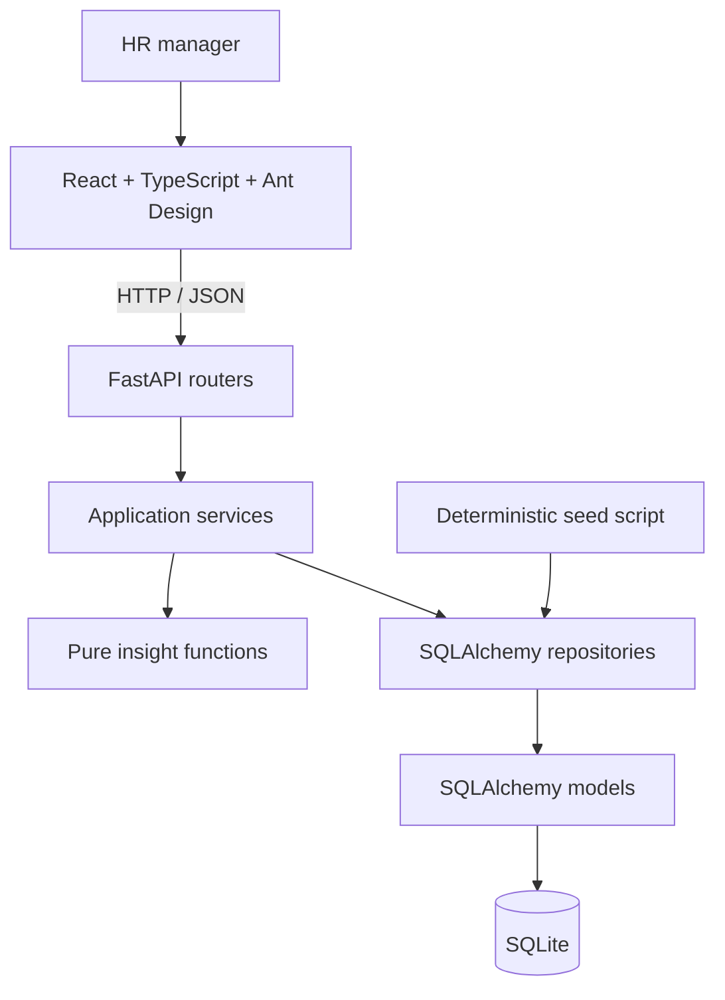

# Salary Management Software: Architecture

**Author:** @Deep Kokje  
**Last updated:** 24 Oct 2026  
**Status:** Proposed design based on [plan.md](./plan.md) and [REQUIREMENTS.md](./REQUIREMENTS.md).

## Overview

A React web app gives one HR manager a salary directory, a pay snapshot and five headline insights for 10,000 employees. A FastAPI backend validates requests, coordinates database access and calculates insights. SQLite keeps local setup simple.

This document describes the intended architecture, not an already implemented system.

## System diagram

## Components and boundaries

| Component | Responsibility |
| --- | --- |
| Frontend | Dashboard, insight drill-downs, employee forms, filters, pagination and CSV download. Built with React, TypeScript, Vite and Ant Design. |
| Routers | Validate HTTP inputs, call application services and translate results or errors into API responses. |
| Application services | Coordinate repository reads and writes, invoke pure calculations and define transaction boundaries. |
| Pure insight functions | Compute statistics, equity gaps, band compliance, peer outliers, benchmarks, FX normalization and what-if costs from supplied data. No database or HTTP access. |
| Repositories | Own SQLAlchemy queries and persistence. Apply filters and pagination in the database rather than loading the entire directory for each page. |
| Models | Define database tables, relationships and integrity constraints. |
| Seed script | Generate repeatable demo data and persist it through repositories using the same model constraints as the app. |

Only repositories access SQLite. Application services may perform I/O through repositories; the calculation functions they call remain pure and independently testable.

## Data model

The following entities support the planned features:

| Entity | Key data and constraints |
| --- | --- |
| Employee | ID, unique email, name, gender, department, title, level, country, base salary in local minor units and currency code. Hire date and an optional manager reference support stretch insights. |
| Salary band | Title, level, country, currency, minimum, midpoint and maximum in minor units. One band per peer group, with minimum <= midpoint <= maximum. |
| Salary history | Employee reference, old salary, new salary, associated currency and change date. Created in the same transaction as a salary change. |
| Fixed FX rate | Currency code and a configurable conversion rate to USD. Fixed inputs make the demo and tests reproducible. |

Reject negative salaries, unsupported currencies and duplicate emails. A salary must use the same currency as its applicable band before local comparisons are made.

### Money and grouping

- Store salaries as integer minor units plus a currency code, never binary floating-point amounts.
- Use decimal arithmetic for FX rates and percentage calculations, with an explicit, tested rounding rule when converting back to minor units.
- Derive USD-normalized amounts for cross-country totals and comparisons; retain local amounts as the source of truth.
- Define a peer group by title + level + country.
- Return an explicit "insufficient data" result for peer-group statistics with fewer than five people. Do not substitute zero for an unavailable statistic.

## Request flows

### Dashboard and insights

1. The frontend requests the pay snapshot and headline insights.
2. Routers validate filters and pass them to application services.
3. Repositories fetch the required employee, band and FX data.
4. Pure functions group records and calculate results.
5. Services return results with eligibility or insufficient-data status.
6. The frontend renders summaries and links to the relevant drill-downs.

### Employee salary update

1. Validate the employee, salary and currency.
2. Read the existing salary through a repository.
3. Update the employee and insert salary history in one transaction if the salary changed.
4. Commit both writes together, or roll back both on failure.
5. Return the saved employee and refresh affected views.

### Directory and CSV export

The directory uses server-side filtering and pagination. CSV export applies the same filters but exports the complete filtered result, not only the visible page.

## Insight calculations

| Insight | Calculation |
| --- | --- |
| Pay equity | Raw gap = (median male - median female) / median male, using USD-normalized pay for cross-country views. Adjusted gap is the group-size-weighted average of this gap across eligible peer groups with both genders. |
| Band compliance | Compare local salary with band minimum and maximum. Compa-ratio = salary / band midpoint. Salaries exactly on a boundary are in band. |
| Peer outliers | Deviation = (salary - peer median) / peer median. Flag deviations strictly beyond -20% or +20% in eligible peer groups. |
| Benchmarks | Compute min, p25, median, p75 and max in Python from salaries grouped by title, level and country. |
| What-if cost | Sum positive shortfalls to band minimum after USD conversion, or calculate X% of the chosen department's USD payroll. Scenarios are read-only and do not change salaries. |
| Pay snapshot | Headcount, payroll and distributions by country, department and level; use USD for totals across currencies. |

Empty inputs, missing bands, missing FX rates and zero denominators must produce explicit unavailable-data or validation results, not fabricated values. The percentile interpolation method and monetary rounding policy must be fixed and tested before implementation.

Compression and inversion, pay progression and geographic comparison remain stretch features. They can reuse peer grouping, salary history and normalization without changing the core layering.

## Performance and validation

- Target directory responses under 300 ms and each insight under 500 ms at 10,000 employees.
- Record query timings and total request timings so database performance is not confused with end-to-end response time.
- Avoid per-employee queries; fetch insight inputs in bounded queries and calculate statistics in memory.
- Add indexes for directory filters and peer-group lookups based on measured queries.
- Use pytest for pure calculations, validation, repository behavior and atomic salary-history updates.
- Use Vitest for frontend filtering, pagination and loading, error and insufficient-data states.
- Seed exactly 10,000 employees deterministically, including a planted equity gap, out-of-band salaries and compression cases.
- Verify that the seeded demo produces a visible gap, out-of-band employees and a non-zero remediation cost.

## Scope and deployment boundary

The initial design excludes authentication, RBAC, payroll, tax, bonuses, equity, live FX, Excel import and approval workflows. It is a local demo design, not a production-ready deployment for sensitive salary data. Authentication and authorization are required before production use.

Repositories isolate persistence details to make a later PostgreSQL migration easier, but that migration still requires schema, transaction and query validation.
